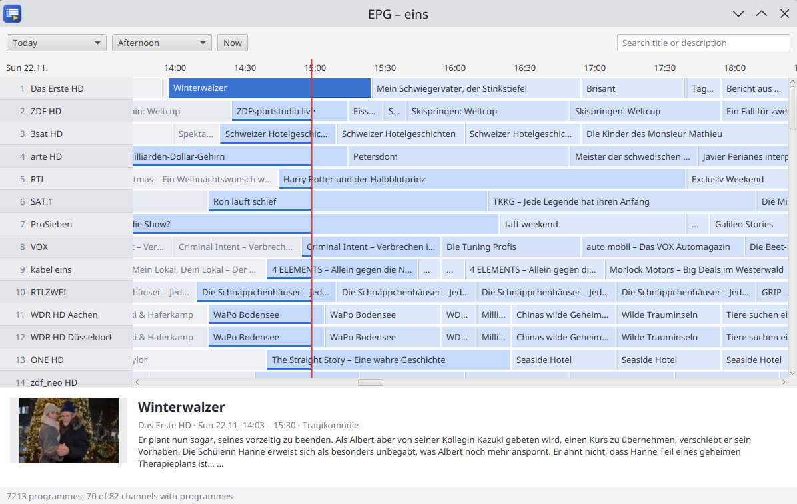

# M3UEditor

M3UEditor is a small desktop editor written in Java based on JavaFX for managing m3u-playlist files: it collects the
entries of several sources, filters, sorts and enriches them and writes the resulting playlist.

* load playlists from local files, URLs, a FritzBox, [iptv-org](https://github.com/iptv-org/iptv) (by country,
  category, language, region or single channels) and SFTP servers
* filter them automatically: channel names (regular expressions), SD channels, duplicate names and URLs, unreachable
  streams
* sort them alphabetically or by a preferred channel order
* see the whole pipeline at a glance and compare the entries before and after each step in a side-by-side diff,
  including the reason why a filter removed an entry
* edit, add, remove, reorder, copy and paste single entries, with undo and redo, shown with the logos of the
  channels, and play them in an external player (VLC by default)
* add a programme guide (EPG) from XMLTV sources and browse it in a TV-like programme guide
* write the playlist to a local file or an SFTP server
* save everything as a project to re-create the playlist later on, also without user interface from the command
  line, e.g. as a cron job
* extensible by plugins of other parties (inputs, filters, sorters, enrichers, outputs)
* in English or German, with a light or dark theme

M3UEditor does not provide any streams or programme guides itself: it only edits playlists of sources you choose.
Please make sure you are allowed to use the streams of your playlists.

## Download

Ready-to-run application images for Linux, Windows and macOS are attached to each
[release](https://github.com/bit-punk/m3uedit/releases). They include a Java runtime, so neither Java nor JavaFX has
to be installed:

| Platform | File                           | Start                                     |
|----------|--------------------------------|-------------------------------------------|
| Linux    | `m3uedit-<version>-linux.tar.gz` | `m3uedit/bin/m3uedit`                   |
| Windows  | `m3uedit-<version>-windows.zip`  | `m3uedit\m3uedit.exe`                   |
| macOS    | `m3uedit-<version>-macos.tar.gz` | `m3uedit.app` (built for Apple Silicon) |

The applications are not signed: Windows asks for confirmation on the first start ("More info" &rarr; "Run anyway"),
on macOS open the application via the context menu ("Open") or remove the quarantine flag using
`xattr -dr com.apple.quarantine m3uedit.app`.

## Getting started

1. Create a new project on the start screen.
2. Add one or more inputs, e.g. the playlist of your FritzBox or the channels of a country from iptv-org.
3. Enable the filters and the sorter you need; the pipeline shows how many entries each step removes or moves, and
   the diff shows which ones.
4. Optionally enable the EPG Enricher to get a programme guide for your channels.
5. Add an output (a local file or an SFTP server) and save the playlist.
6. Save the project, so the playlist can be re-created with the current channels of your inputs later on.

## Documentation

* [User guide](docs/user-guide.md): projects, the pipeline and its plugins, editing the playlist, the diff, the
  programme guide, keyboard shortcuts
* [Configuration](docs/configuration.md): the configuration dialog and the configuration files
* [Command-line mode](docs/command-line.md): running projects without user interface, e.g. as a cron job
* [Development](docs/development.md): building, the architecture, versions and releases
* [Writing plugins](docs/plugins.md): plugins of your own against the published plugin API, from an empty project to
  an installed jar

## Contributing

Bug reports, ideas and pull requests are welcome, see [CONTRIBUTING.md](CONTRIBUTING.md).

## License

M3UEditor is licensed under the [MIT License](LICENSE.md).
