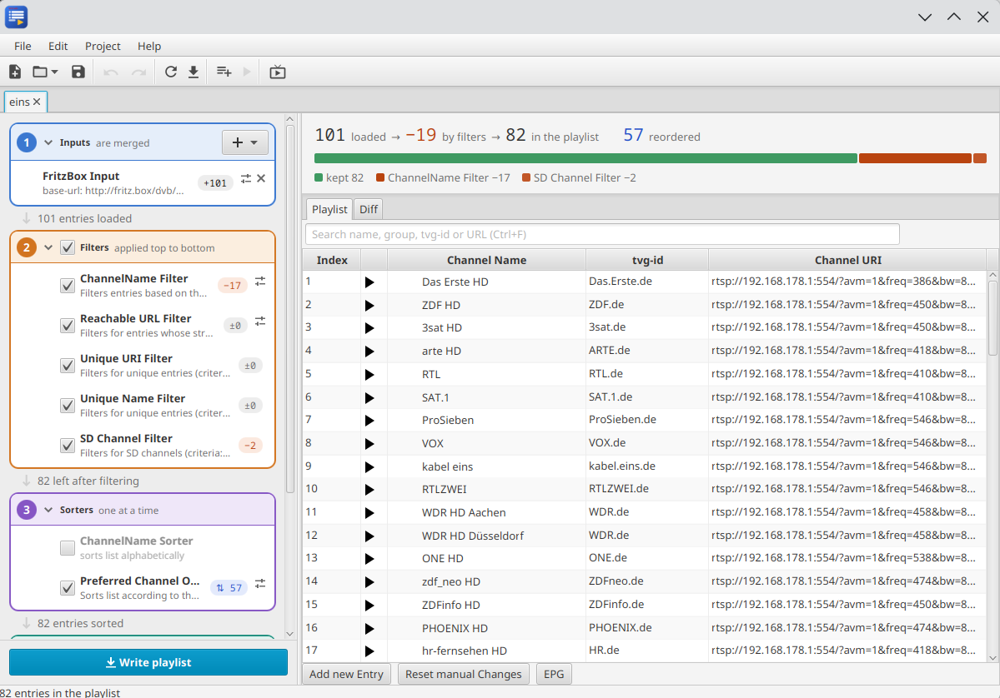

# M3UEditor



M3UEditor is a small desktop editor written in Java based on JavaFX for managing m3u-playlist files: it collects the
entries of several sources, filters, sorts and enriches them and writes the resulting playlist.

* load m3u-playlists from various sources: local files, URLs, a FritzBox, [iptv-org](https://github.com/iptv-org/iptv)
  (by country, category, language, region or single channels) and SFTP servers
* automatically filter the playlist using the built-in filters: channel names (regular expressions), SD channels,
  duplicate names, duplicate URLs and unreachable URLs
* sort the entries of your playlist alphabetically or by a preferred channel order (custom profiles can be created
  from existing playlists)
* see the whole pipeline at a glance: inputs, filters, sorters and outputs, each with the number of entries it
  removed or moved; filters and sorters are enabled and reordered right there
* compare the entries before and after each step in a side-by-side diff, including the reason why a filter removed
  an entry (e.g. `"ZDF HD" exists` or `same URL as "Das Erste HD"`)
* edit, add, remove and reorder single entries of the playlist, shown with the logos of the channels, and play them
  in an external player (vlc by default)
* save the resulting playlist to a local file or an SFTP server
* add a programme guide (EPG) with the EPG Enricher: it assigns the entries to the channels of XMLTV sources (e.g.
  [epgshare01](https://epgshare01.online)) by setting their `tvg-id` - matched by `tvg-id`, URL rules (regular
  expressions on the stream URL), name or the first words of the name - and writes a guide containing only the
  channels of the playlist next to it (`tv.m3u` &rarr; `tv.xml.gz`), referenced by the playlist header; sources are
  cached in `~/.m3uedit/cache/epg`. Without enricher, the EPG URLs of the inputs (`x-tvg-url` / `url-tvg`) are kept
* browse the programmes of all channels of the playlist in a TV-like programme guide, which follows the changes of
  the playlist; channels are played from there as well
* save your inputs, filters, sorters, enrichers and outputs as project (`*.m3uproj`) to re-create the playlist later
  on; recently used projects are listed on the start screen and in the file menu
* run a project without user interface from the command line, e.g. as a cron job, see
  [Command-line mode](#command-line-mode)

M3UEditor does not provide any streams or programme guides itself: it only edits playlists of sources you choose.
Please make sure you are allowed to use the streams of your playlists.


## Download

Ready-to-run application images for Linux, Windows and macOS are attached to each
[release](https://github.com/bit-punk/m3uedit/releases). They include a Java runtime, so neither Java nor JavaFX has
to be installed:

| Platform | File                           | Start                                     |
|----------|--------------------------------|-------------------------------------------|
| Linux    | `m3uedit-<version>-linux.tar.gz` | `m3uedit/bin/m3uedit`                   |
| Windows  | `m3uedit-<version>-windows.zip`  | `m3uedit\m3uedit.exe`                   |
| macOS    | `m3uedit-<version>-macos.tar.gz` | `m3uedit.app` (built for Apple Silicon) |

The applications are not signed: Windows asks for confirmation on the first start ("More info" &rarr; "Run anyway"),
on macOS open the application via the context menu ("Open") or remove the quarantine flag using
`xattr -dr com.apple.quarantine m3uedit.app`.

## Getting started

1. Create a new project on the start screen.
2. Add one or more inputs, e.g. the playlist of your FritzBox or the channels of a country from iptv-org.
3. Enable the filters and the sorter you need; the pipeline shows how many entries each step removes or moves, and
   the diff shows which ones.
4. Optionally enable the EPG Enricher to get a programme guide for your channels.
5. Add an output (a local file or an SFTP server) and save the playlist.
6. Save the project, so the playlist can be re-created with the current channels of your inputs later on.

## Command-line mode

A project created with the user interface can be run without it, e.g. by a cron job that keeps a playlist up to
date. The inputs are read, the filters, the sorter and the enrichers are applied and the playlist is written to the
outputs of the project:

```bash
m3uedit --run ~/playlists/tv.m3uproj
```

| Option                      | Meaning                                                                         |
|-----------------------------|---------------------------------------------------------------------------------|
| `-r`, `--run <project-file>` | the project to run; can be given several times, the projects run one after another |
| `-n`, `--dry-run`           | run the pipeline, but do not write to the outputs                               |
| `--ignore-input-errors`     | write the playlist although some inputs could not be read                       |
| `-q`, `--quiet`             | only print errors                                                               |
| `-v`, `--verbose`           | print details of the run                                                        |
| `-h`, `--help`              | print the help                                                                  |
| `--version`                 | print the version                                                               |

Without options, the user interface is started as before.

**A working playlist is not replaced by an incomplete one:** it is not written if an input could not be read (e.g.
the FritzBox is offline), if no entries have been read at all or if the playlist is empty after filtering.
`--ignore-input-errors` writes the entries of the inputs that could be read, but never an empty playlist.

**Exit codes:** `0` all projects have been run and written, `1` a project could not be run or written, `2` wrong
options or a project-file that could not be loaded. The result of each project is printed to stdout, errors to
stderr.

**SFTP:** the passwords of SFTP inputs and outputs are not stored in the project, they are taken from environment
variables:

| Variable                               | Password of                                                        |
|----------------------------------------|--------------------------------------------------------------------|
| `M3UEDIT_SFTP_PASSWORD_<USER>_<HOST>` | the user `<user>` on the server `<host>`, e.g. `M3UEDIT_SFTP_PASSWORD_ROOT_192_168_178_22` for `root@192.168.178.22` |
| `M3UEDIT_SFTP_PASSWORD`                | all other servers, e.g. if there is only one                       |

User and host are written in upper case, all characters except letters and digits are replaced by `_`. If a
password is missing, the error names the variable expected. Unknown host keys are rejected, so connect to a server
once using the user interface to accept its key. Existing files on the server are overwritten without asking.

The command is `m3uedit/bin/m3uedit` in the Linux download (or `java -jar m3uedit-<version>-linux.jar` with a JDK
25+) and `m3uedit.app/Contents/MacOS/m3uedit` on macOS. The launcher of the Windows download has no console, so the
output of a run is not shown there.

Example for a cron job updating the playlist every night at 4:00 (`crontab -e`):

```
0 4 * * * M3UEDIT_SFTP_PASSWORD_ROOT_192_168_178_22='…' /opt/m3uedit/bin/m3uedit --quiet --run /home/me/playlists/tv.m3uproj
```

With `--quiet`, cron only sends a mail if something went wrong.

## Configuration

Besides the project files, the configuration is stored in the directory `~/.m3uedit`. The files are created with
default values on first use and can be edited by hand:

| File                                   | Content                                                     |
|----------------------------------------|-------------------------------------------------------------|
| `external_player.yaml`                 | command and arguments of the external player (vlc)          |
| `recent_projects.yaml`                 | recently used projects, `maxEntries` sets how many (10)     |
| `plugins/channel_name_filter.yaml`     | regular expressions of channel names to filter              |
| `plugins/epg_enricher.yaml`            | EPG sources a new EPG Enricher starts with                  |
| `plugins/preferred_channel_order.yaml` | profiles with the preferred order of channels               |
| `plugins/reachable_url_filter.yaml`    | connect-timeout used to check whether a stream is reachable |
| `plugins/sftp_recent_servers.yaml`     | recently used SFTP servers (passwords are never stored)     |
| `cache/epg/`                           | downloaded EPG sources                                      |

A different directory can be used by setting the system property `m3uedit.config.dir`, e.g.
`java -Dm3uedit.config.dir=/tmp/m3uedit -jar target/m3uedit-<version>.jar`.

## Building

Prerequisites:

* JDK 25+
* Linux, Windows, macOS

JavaFX is pulled in by Maven, a separate JavaFX SDK is not needed.

To build m3uedit, open a terminal, navigate to the directory where you have checked out the sources and invoke the
[maven-wrapper](https://maven.apache.org/wrapper/):

```bash
./mvnw clean install
```

To run the application using the _javafx-maven-plugin_, use:

```bash
./mvnw javafx:run
```

After a successful build you will find the resulting jar under `./target/m3uedit-<version>.jar` (e.g.
`m3uedit-1.1.0-SNAPSHOT.jar`, see [Versions](#versions)), which can be
started using `java -jar target/m3uedit-<version>.jar`. The jar contains the JavaFX libraries of the platform it
has been built on, so it only runs on that platform.

To create a self-contained application image for your current platform (including a java runtime, no separate JDK
or JavaFX installation needed), use the `jpackage` profile:

```bash
./mvnw -Pjpackage package
```

The application can then be started using `./target/dist/m3uedit/bin/m3uedit` (Linux) or the corresponding launcher
on Windows/macOS.

## Developing

* To run the application from the IDE, create a run-configuration for the class `org.bitpunk.m3uedit.Main`. It does
  not extend `javafx.application.Application`, so the JavaFX libraries can be used from the classpath and no module
  path is needed.
* Inputs, filters, sorters, enrichers and outputs are plugins, found by the Java
  [ServiceLoader](https://docs.oracle.com/en/java/javase/25/docs/api/java.base/java/util/ServiceLoader.html) via the
  files in `src/main/resources/META-INF/services`. The pipeline they form is described in
  [src/main/doc/Playlist.md](src/main/doc/Playlist.md).
* Tests use a temporary configuration directory instead of `~/.m3uedit`
  (see `src/test/java/org/bitpunk/m3uedit/testsupport/TestConfigDirListener.java`), in Maven as well as in the IDE.
  Some tests show windows, so on a machine without display run them using `xvfb-run ./mvnw package`.

### Versions

The version is defined once, by the release on GitHub: building a release (`.github/workflows/release.yml`) sets
the version of its tag (`-Drevision=1.2.0`) for the jar, the application image and the about dialog. Local builds
use the `revision` of the `pom.xml`, the next release as snapshot (e.g. `1.1.0-SNAPSHOT`); it only needs to be
raised by a pull request when a release has been published.

See [CONTRIBUTING.md](CONTRIBUTING.md) for how to contribute.

### Links

* [JavaFX](https://openjfx.io/) and its [documentation](https://openjfx.io/openjfx-docs/)
* [M3U](https://en.wikipedia.org/wiki/M3U) and the [XMLTV format](https://github.com/XMLTV/xmltv/blob/master/xmltv.dtd)
* [Fritz DVB to VLC](https://github.com/passing/fritz-dvb-to-vlc): the playlists of a FritzBox
* [Java Service Provider Interface](https://www.baeldung.com/java-spi)

## License

M3UEditor is licensed under the [MIT License](LICENSE.md).
